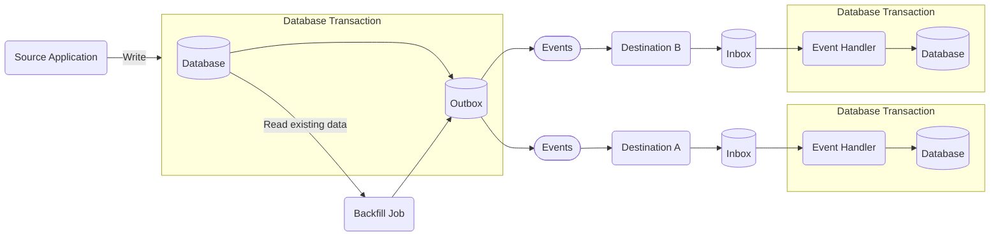

# Replica

Replica is a Java library for replicating events (changes) from one application to others.

Applications exchange events rather than database records, so the source and destination can use the same or different
schemas. Each application handles incoming events with its own event handlers.



The source writes each event to an outbox in the same transaction as the change. Each destination receives events
through its inbox and applies them in order. Delivery is at least once.

If a destination needs the existing data, such as one added later, you can start a backfill job. It copies the data,
converting each record into an event and writing it to the outbox. Writes on the source are not blocked while it runs
([how](replica-core/docs/backfill.md)). See the [`replica-core` guide](replica-core/README.md) for how it works.

It comes with a runnable playground: a master and slaves on local H2 databases, and a web app to change data and watch
it arrive.

## Modules

- [`replica-core`](replica-core): The core replication library
- [`replica-spring-jpa`](replica-spring-jpa): Spring Data JPA implementation of the core interfaces
- [`replica-integration-test`](replica-integration-test): Integration tests on H2 databases
- [`replica-playground-api`](replica-playground-api): Playground with a master and slave on H2 databases
- [`replica-playground-web`](replica-playground-web): Playground web app to interact with the master and slaves

## Running the playground

Needs Java 21 and Node.js. Copy `.env.example` to `.env`, then run each in its own terminal:

```
./gradlew runMaster    # http://localhost:8080
./gradlew runSlave1    # http://localhost:8081
./gradlew runWeb       # http://localhost:5173
```

Open http://localhost:5173 and, on the Stations page, add the slave at `http://localhost:8081`. It gets the existing
data, then every new change.

More slaves: `./gradlew runSlave2` (port 8082), or `./gradlew runSlave -Pstation=<name> -Pport=<port>`.

## Running the tests

```
./gradlew test
```
